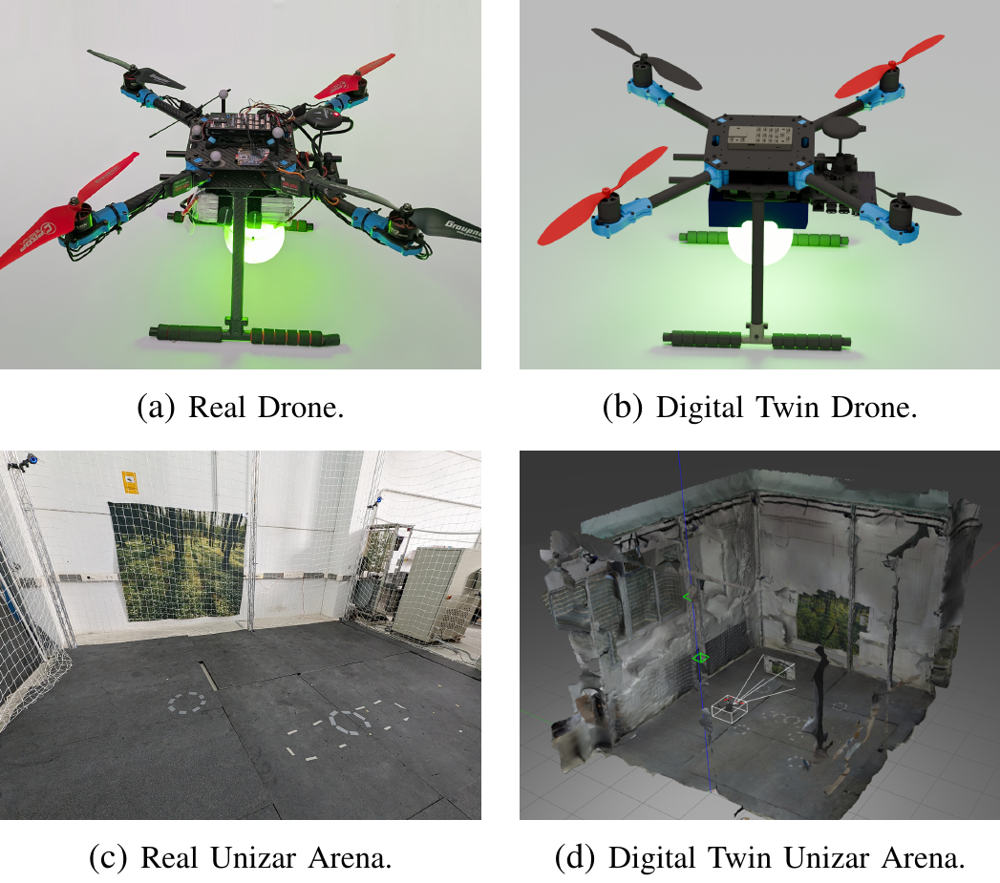
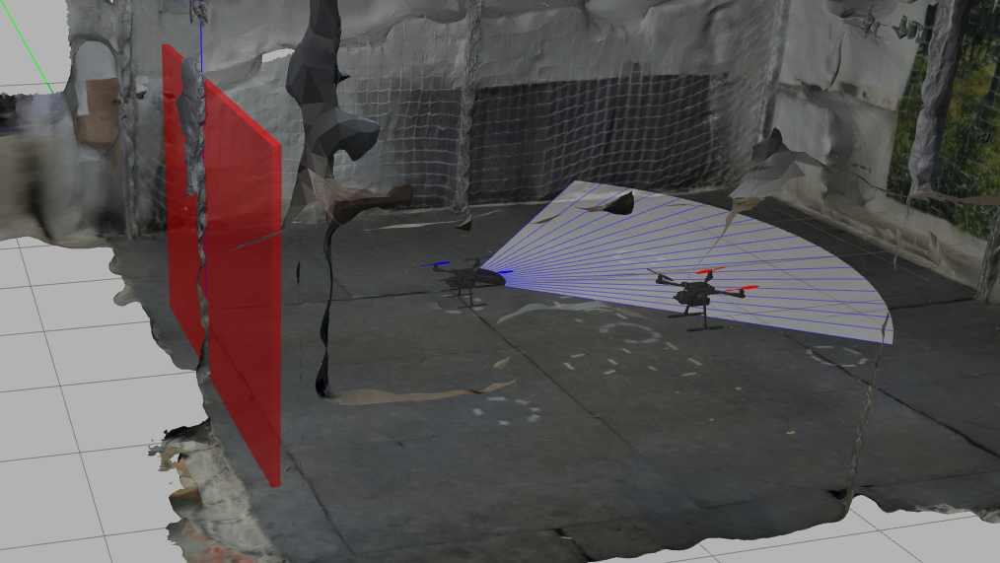

# Vincent Digital Twin

Digital-twin framework for an autonomous quadrotor (PX4 + ROS 1 Noetic + Gazebo Classic), developed at DIIS-I3A, Universidad de Zaragoza.

<p align="center"></p>
<p align="center"><sub>Real world (left) and its digital twin (right): the drone (top) and the Unizar flight arena (bottom).</sub></p>

## Paper
> **Digital Twins for Autonomous Drone Deployment** — J. Dendarieta, L. Riazuelo, E. Montijano (DIIS-I3A, Universidad de Zaragoza). Under revision; link and citation will be added after publication.

## Overview
The same software stack (trajectory publisher, ROS/MAVROS, PX4) runs on the **Real drone** and on its **Digital twin** (PX4 SITL in a Gazebo replica of the arena); switching between them only changes networking settings. The repository is meant to be **completed with a trajectory generator** (not included): any generator that exports a time-parameterised trajectory (`q, qd, qdd, tvec`, see [`matlab/README.md`](matlab/README.md)) can be flown on either. An example trajectory (Nikolaus) is included.

The twin is also connected **back** to the real drone: the motion-capture pose of the real drone drives a *Mirror* inside Gazebo, and virtual sensors on the Mirror perceive objects that exist only in the twin. A virtual wall, seen by a virtual range sensor, stops the real drone through PX4 Collision Prevention:

<p align="center"><a href="https://youtu.be/cXBxUWjQOjg"></a></p>

<p align="center"></p>
<p align="center"><sub>Twin world (Gazebo): reconstructed arena, a virtual wall that exists only here, the Mirror of the Real drone with its virtual scan, and the Digital twin.</sub></p>

## Repository layout
```
vincent_twin/   ROS package: twin world, Mirror, Digital twin (PX4 SITL) launch, virtual sensors, tools
matlab/         trajectory publisher (Real drone or Digital twin), metrics, example trajectory
px4_models/     PX4 Gazebo models used by the twin (drone, arena)
config/         PX4 parameter files and the companion-computer (NanoPi) MAVROS launch
docs/           installation, running, architecture, experiments
```

## Install and run
- Installation: [`docs/INSTALL.md`](docs/INSTALL.md)
- Running the Digital twin next to the Real drone: [`docs/RUN_SITL.md`](docs/RUN_SITL.md)
- Architecture (components, data paths, ports): [`docs/ARCHITECTURE.md`](docs/ARCHITECTURE.md)
- Experiments: [`docs/EXPERIMENTS.md`](docs/EXPERIMENTS.md)

## Hardware
Holybro X500 V2, Pixhawk 6C (PX4 1.16), NanoPi companion (MAVROS), T-Motor Velox V2812 925KV, 9×4 props, 6S, take-off mass 2.15 kg. OptiTrack motion capture (Motive 3.1, VRPN).

## Citation
Will be added after publication (see [Paper](#paper)).
